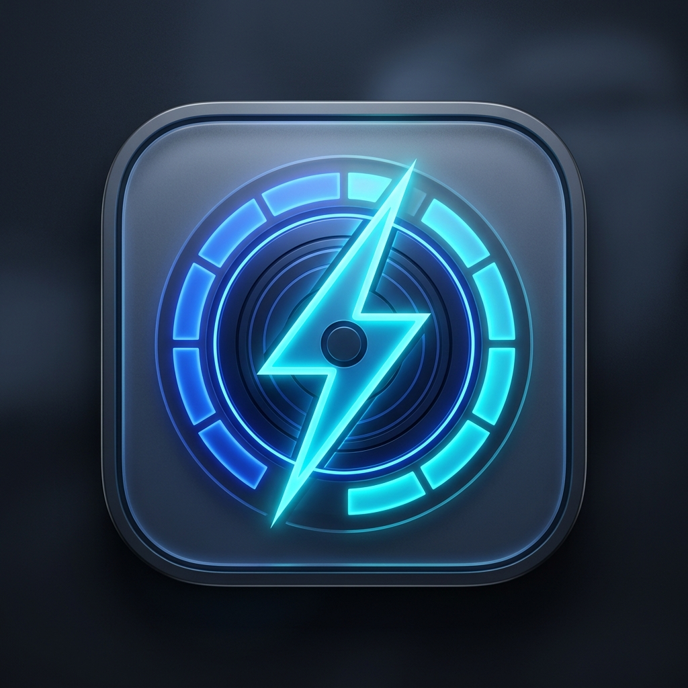

# Voltrex Light — Modern Windows 11 Storage & Disk-Space Analyzer

<p align="center">
  
</p>

<p align="center">
  <strong>High-performance native Windows 11 disk space analyzer & visualization suite.</strong><br>
  <em>Developed by <b>mohomed Ziard | Voltrex Digital</b></em>
</p>

<p align="center">
  
  
  
  
  
  
</p>

---

## Overview

**Voltrex Light** is a native, modern Windows 11 disk analyzer built from the ground up using **C#**, **.NET 8**, **WinUI 3**, **XAML**, and the **Windows App SDK**. Designed as a contemporary alternative to legacy tools like TreeSize, WinDirStat, and KDE Filelight, Voltrex Light delivers high-speed recursive traversal, vector-rendered interactive visualizations (Radial Sunburst and Squarified Treemap), and seamless Windows 11 Fluent Design integration.

---

## Key Features

### 🌟 Windows 11 Fluent Design & Native Shell
- **Translucent Mica Backdrop**: Uses native `MicaBackdrop` for Windows 11 desktop integration with support for system Light, Dark, and High Contrast modes.
- **Custom Modern Titlebar**: Extended client area with integrated branding, draggable region, scale-aware caption button insets, and live status pills.
- **Administrator Elevation Badge**: Visual badge indicating elevated administrator status, with a one-click **"Run as Admin"** prompt to restart the app with elevated rights for complete disk and system file visibility.
- **Compact & Adaptive Sidebar**: Optimized 220px `NavigationView` with drive icons, dynamic disk volume items, and responsive adaptation for narrow window sizes.

### ⚡ High-Performance Disk Scanning Engine
- **Non-Blocking Traversal**: Asynchronous background scanning engine utilizing worker threads with throttled UI updates (~60 ms interval).
- **Reparse Point & Junction Cycle Avoidance**: Safely identifies NTFS hard links, symbolic links, and volume mount points to prevent infinite loops and storage double-counting.
- **64-bit Exact Precision**: Arithmetic precision across multi-terabyte drives with support for both Standard decimal (`KB`, `MB`, `GB`, `TB`) and IEC binary (`KiB`, `MiB`, `GiB`, `TiB`) units.
- **Graceful Permission Recovery**: Access-denied system folders are cataloged safely into partial scan warnings rather than aborting scans.

### 📊 Interactive Visualizations (Sunburst & Treemap)
- **Filelight-Style Radial Sunburst**:
  - Center disc representing root directory; concentric outer rings representing successive directory depths.
  - Angular interval containment ensuring strict parent-child spatial hierarchy.
  - Interactive drill-down (double-click) and navigate-up (center-disc click).
- **Squarified Treemap**:
  - Bruls, Huizing, and van Wijk layout algorithm optimizing rectangle aspect ratios for legible labels.
  - Proportional space-filling representation with color palette classification.
- **Unified Visualizer Host**:
  - Instant switching between Radial Sunburst and Squarified Treemap views.
  - Adjustable recursion depth levels (1 to 6 layers) and optional on-chart label toggles.
  - Continuous breadcrumb navigation trail with Up and Home navigation shortcuts.

### 🔍 Unified Storage Analysis Workspace
- Consolidates drive-level and folder-level analysis into a single, cohesive workflow.
- Multi-column sortable table (Name, Size, % of Folder, % of Root, Files, Folders, and Modified date).
- Live search and filter field with `Ctrl+F` hotkey activation.
- Collapsible contextual properties panel displaying item details, size ratios, badges, and quick actions.

### 🖱️ Windows Shell & File Context Menu
Right-clicking any file or folder row provides access to native Windows shell operations:
- **Open (Enter)**: Launch files in default system associations or drill into folders.
- **Open With...**: Choose alternative applications to open specific files.
- **Explore Folder**: Open target directories in Windows Explorer.
- **Show in Windows Explorer**: Highlight the selected item inside Windows Explorer with `/select` arguments.
- **Copy Full Path (Ctrl+C)**: Copy absolute paths directly to the Windows clipboard.
- **Scan from here**: Start a targeted sub-scan rooted at the selected directory.
- **Move to Recycle Bin (Delete)**: Safely recycle files/folders using native Windows shell file APIs.
- **Permanently Delete (Shift+Delete)**: Permanent deletion with confirmation safeguards.
- **Properties (Alt+Enter)**: View full properties, size, attributes, and file counts.

### 📡 Real-Time Scanning Indication System
- **Global Titlebar Pill**: Displays active "Scanning" state with live item counter (`X items`), scanned volume (`Y GB`), and one-click Cancel (✕) button.
- **Sidebar Badges**: Pulsing `InfoBadge` on the Storage Analysis tab and on the specific storage drive currently undergoing analysis.
- **Analysis Page Loading Card**: Centered Fluent card during initial volume scans with a 44×44 `ProgressRing`, live directory path traversal display, elapsed timer, and cancel button.
- **Background Rescan Banner**: Compact banner above tables for non-blocking rescans.
- **Overview Card State**: "Analyze" button dynamically transforms into an active "Scanning..." indicator with an embedded spinner.

### 🏆 Largest Files Workspace
- Quickly scan and identify top disk-space consumers across the scanned tree.
- Filter by category: **Documents**, **Videos**, **Audio**, **Images**, **Archives**, **Executables**, **Code**, and **Other**.
- Filter by minimum size thresholds (`> 1 MB`, `> 10 MB`, `> 50 MB`, `> 100 MB`, `> 500 MB`, `> 1 GB`).
- Sort by Size, Name, Date Modified, or Extension.

### 💾 Data Export & Privacy
- **RFC 4180 CSV Export**: Complete directory tree export with escaped quotes, commas, and exact byte counts.
- **Hierarchical JSON Export**: Documented schema (`schemaVersion: "1.0"`) with scan metadata, warnings, and recursive nodes.
- **100% Offline & Private**: Zero telemetry, no external network requests, and complete local processing.

---

## Keyboard Shortcuts

| Shortcut | Action |
|:---|:---|
| <kbd>Enter</kbd> | Drill down into folder / Open file |
| <kbd>Backspace</kbd> or <kbd>Alt</kbd>+<kbd>Up</kbd> | Navigate to parent directory |
| <kbd>Ctrl</kbd>+<kbd>F</kbd> | Focus search and filter input |
| <kbd>Ctrl</kbd>+<kbd>C</kbd> | Copy selected item's full path |
| <kbd>Delete</kbd> | Move selected item to Recycle Bin |
| <kbd>Shift</kbd>+<kbd>Delete</kbd> | Permanently delete selected item |
| <kbd>Alt</kbd>+<kbd>Enter</kbd> | Open properties panel / dialog |

---

## Architecture Overview

```
voltrex-light/
├── Converters/                    # XAML Value Converters (Size, Percentage, Color, Visibility)
├── Helpers/                       # MVVM foundation, commands, elevation & formatters
│   ├── AdminElevationHelper.cs    # UAC elevation restart logic
│   ├── AsyncRelayCommand.cs       # Async ICommand implementation
│   ├── FileSystemFormatter.cs     # Standard vs IEC binary byte formatters
│   ├── ObservableObject.cs        # INotifyPropertyChanged base
│   ├── RelayCommand.cs            # Synchronous RelayCommand
│   └── WindowsShellHelper.cs      # Native shell, Recycle Bin & Explorer interop
├── Models/                        # Domain models
│   ├── AppSettings.cs             # Application configuration
│   ├── DriveItem.cs               # Storage volume representation & metrics
│   ├── FileSystemNode.cs          # Hierarchical file tree node with aggregations
│   ├── ScanHistoryItem.cs         # Persisted scan record
│   ├── ScanOptions.cs             # Scan configuration parameters
│   ├── ScanProgressInfo.cs        # Throttled live scanning metrics
│   ├── ScanResult.cs              # Immutable scan result bundle
│   ├── ScanStatus.cs              # State enumeration (Idle, Scanning, Completed, etc.)
│   └── ScanWarning.cs             # Inaccessible path & reparse point logging
├── Services/                      # Application & System Services
│   ├── AppServices.cs             # Dependency injection & service locator
│   ├── DriveService.cs            # System drive enumeration & capacity monitoring
│   ├── ExportService.cs           # RFC 4180 CSV and JSON schema export
│   ├── FolderPickerService.cs     # Native WinRT FolderPicker integration
│   ├── NavigationService.cs       # Page routing & parameter passing
│   ├── ScanHistoryService.cs      # Persistent scan history management
│   ├── ScanService.cs             # Recursive, asynchronous file scanning engine
│   ├── SettingsService.cs         # Settings serialization & theme management
│   └── UpdateService.cs           # Update checking, downloading & installation engine
├── ViewModels/                    # MVVM ViewModels
│   ├── MainViewModel.cs           # Root window, titlebar & sidebar logic
│   ├── OverviewViewModel.cs       # System drives dashboard
│   ├── StorageAnalysisViewModel.cs# Unified storage workspace, breadcrumbs & shell actions
│   ├── LargestFilesViewModel.cs   # Top consumers filter & sort engine
│   └── SettingsViewModel.cs       # Application settings & history management
├── Views/                         # WinUI 3 XAML Pages & Windows
│   ├── MainWindow.xaml (.cs)      # Root application shell with NavigationView & titlebar
│   ├── OverviewPage.xaml (.cs)    # Drive cards, aggregate capacity & quick actions
│   ├── StorageAnalysisPage.xaml (.cs) # Hierarchical table, visualizer host & details panel
│   ├── LargestFilesPage.xaml (.cs)# Top files table, category chips & filters
│   └── SettingsPage.xaml (.cs)    # Theme selection, unit preferences & history
├── Visualizations/                # Interactive Visualization Engine
│   ├── Controls/
│   │   ├── DiskSpaceVisualizerControl.xaml (.cs) # Unified visualizer host & breadcrumbs
│   │   ├── SunburstControl.xaml (.cs)            # Filelight radial canvas renderer
│   │   └── TreemapControl.xaml (.cs)             # Squarified canvas treemap renderer
│   ├── Engines/
│   │   ├── PaletteProvider.cs                    # Accessible Fluent color palettes
│   │   ├── SquarifiedTreemapEngine.cs            # Squarified geometric layout
│   │   └── SunburstLayoutEngine.cs               # Polar coordinate layout engine
│   └── Models/
│       ├── SunburstSlice.cs                      # Polar wedge data & hit test bounds
│       ├── TreemapItem.cs                        # Rectangle coordinates & hit test bounds
│       └── VisualizationBreadcrumbItem.cs        # Breadcrumb trail entry
└── tests/voltrex-light.Tests/     # Comprehensive MSTest Suite (57 automated tests)
    ├── DriveItemTests.cs
    ├── DriveServiceTests.cs
    ├── ExportServiceTests.cs      # CSV RFC 4180 escaping & JSON schema tests
    ├── FileSystemFormatterTests.cs# Byte & percentage formatting tests
    ├── LargestFilesViewModelTests.cs
    ├── OverviewViewModelTests.cs
    ├── RelayCommandTests.cs
    ├── ScanHistoryServiceTests.cs
    ├── ScanServiceTests.cs        # Traversal, cancellation & permission tests
    ├── ScanSortingTests.cs
    ├── SettingsServiceTests.cs
    └── VisualizationEngineTests.cs# Sunburst angles, Treemap aspect ratios & hit-testing
```

---

## Building and Running

### Prerequisites
- **Operating System**: Windows 10 version 1809 (Build 17763) or Windows 11 (Windows 11 22H2+ recommended).
- **SDK**: [.NET 8.0 SDK](https://dotnet.microsoft.com/download/dotnet/8.0).
- **Workloads**: Visual Studio 2022 v17.10+ / Visual Studio 2026 with:
  - *.NET Desktop Development*
  - *Windows App SDK C# Templates*

### Build Debug (x64)
```powershell
dotnet build voltrex-light.csproj -p:Platform=x64
```

### Build Release (x64)
```powershell
dotnet build voltrex-light.csproj -c Release -p:Platform=x64
```
The standalone, unpackaged desktop executable will be located at:
```
bin\x64\Release\net8.0-windows10.0.19041.0\win-x64\voltrex-light.exe
```

### Running Unit Tests
```powershell
dotnet test tests/voltrex-light.Tests/voltrex-light.Tests.csproj
```

---

## Quality Assurance & Test Coverage

The automated test suite covers 57 unit tests across core subsystems:
- **Visualizer Layout Engines**: Treemap squarification aspect ratios, space-filling conservation, and Sunburst radial wedge angle interval containment.
- **Formatting & Units**: Exact 64-bit byte representations across standard and IEC binary unit conventions.
- **Export Verification**: RFC 4180 CSV quote and comma escaping, 64-bit precision, and JSON schema parsing.
- **Safety & History**: FIFO history pruning (capped at 50 records) and persistent storage in `%LOCALAPPDATA%\VoltrexLight\history.json`.
- **Filtering & Scope**: Category detection, file extension classification, and size threshold boundaries.

---

## Authors & Attribution

- **Developer**: mohomed Ziard
- **Organization**: [Voltrex Digital](https://voltrexdigital.com)
- **Project**: Voltrex Light (Storage & Disk-Space Analyzer)

---

## License

This project is licensed under the [MIT License](LICENSE).

